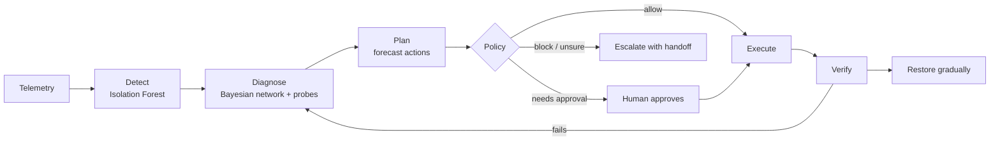

# Architecture

## Overview

SentinelOps is an agent that operates a simulated anycast DNS network. Every
simulated second it reads noisy telemetry from each site, decides whether
something is wrong (**detect**), works out the most likely cause (**diagnose**),
compares candidate repairs by simulating each one forward (**plan**), checks
whether operator policy lets it act (**authorise**), carries out the chosen
action (**execute**), confirms that service has really recovered (**verify**),
and then either returns traffic gradually (**restore**) or hands the incident to
an engineer with a written report (**escalate**). The same seeded incidents are
also given to a simple threshold-rule agent so the two can be compared fairly.

## Anycast DNS in 60 seconds

A DNS operator can announce the *same* service address from many sites at once.
This is called anycast. Internet routing sends each client to the nearest site
that is currently announcing the address. The set of clients a site serves is
its *catchment*.

If a site is broken, the operator can **withdraw** it: the site stops announcing
the address and its whole catchment moves to each client's next-nearest site.
That removes the broken site from the path, but the neighbour now carries its
own traffic plus the moved traffic. If the neighbour lacks the capacity, its
queue fills and it starts failing queries too. A good repair therefore depends
on the state of the *whole* network, not only the broken site.

## The simulated network

The simulator models six sites, each with two DNS servers behind a bounded
queue.

| Site ID | City | Servers |
|---|---|---|
| `ott` | Ottawa | `ott-1`, `ott-2` |
| `yyz` | Toronto | `yyz-1`, `yyz-2` |
| `lon` | London | `lon-1`, `lon-2` |
| `fra` | Frankfurt | `fra-1`, `fra-2` |
| `par` | Paris | `par-1`, `par-2` |
| `sin` | Singapore | `sin-1`, `sin-2` |

- **Time.** One tick is one simulated second. Rates are per tick, so a rate is
  the same number as queries per second (qps).
- **Servers.** Each server has a capacity: the most queries it can answer per
  tick when healthy.
- **Queues.** Each site has a queue with a fixed limit and a timeout. Queries
  that arrive when the queue is full are dropped; queries that wait longer than
  the timeout fail.
- **Client regions.** Demand comes from client regions (for example `na-east`
  or `eu-west`), each with a mean legitimate query rate. Every region has a
  routing preference list of sites, nearest first; its traffic goes to the first
  site on the list that is announcing.
- **Failed queries.** A query fails if it is *rejected* by a rate limit,
  dropped by queue *overflow*, *timed out* in the queue, or *lost* on the
  network path.

## The agent loop



- **Detect** scores windows of site telemetry with an Isolation Forest trained
  on healthy behaviour and raises an alert when a site looks unusual.
- **Diagnose** keeps a probability for each possible fault using a Bayesian
  network, and chooses diagnostic probes that are expected to reduce
  uncertainty the most per second spent.
- **Plan** forecasts the network's queues over a short horizon for each candidate
  action and each plausible fault, and ranks actions by the failed queries they
  are expected to prevent minus a penalty for disruption.
- **Policy** is a rule-based system that decides, for each proposed action,
  whether it is allowed, blocked, or needs a human's approval.
- **Verify** requires recovery checks to hold for several consecutive ticks;
  traffic then returns in steps and is rolled back if errors come back.
- **Escalate** produces a handoff report for an engineer when the agent cannot
  or may not fix the problem itself.

## Module map

All code lives in the `sentinelops` package under `src/`.

| Package | Responsibility | Owner |
|---|---|---|
| `sim` | Topology, routing, traffic, queues, telemetry, actions, simulation engine | Mohamed |
| `sim` (faults) | Fault kinds and their effects on the network | Yassin |
| `scenarios` | Seeded fault scenario families | Yassin |
| `detect` | Telemetry features and Isolation Forest anomaly detection | Yassin |
| `diagnose` | Bayesian network diagnosis and probe selection | Mohamed |
| `plan` | Recovery forecasting and incident prioritisation | Mohamed |
| `policy` | Autonomy presets, policy rules and approvals | Yassin |
| `verify` | Recovery checks and gradual restoration with rollback | Yassin |
| `agent` | The SentinelOps agent that wires the loop together | Mohamed |
| `agent` (handoff) | Engineer handoff reports | Yassin |
| `baselines` | Threshold-rule baseline agent | Yassin |
| `eval` | Experiment runner and statistics | Mohamed |
| `api` | API for the operations console | Mohamed |
| `web` | Operations console with a live globe of site health | Mohamed |

## Key interfaces

Modules talk to each other only through the types below. Value types are frozen
dataclasses, kinds are string enums, and mappings passed between modules are
read-only.

### Topology

The topology is the fixed description of the network: sites, servers, client
regions and each region's routing preferences.

```python
SiteId = NewType("SiteId", str)  # "ott", "yyz", "lon", "fra", "par", "sin"
ServerId = NewType("ServerId", str)  # "ott-1", "ott-2", ...
RegionId = NewType("RegionId", str)  # "na-east", "eu-west", ...


@dataclass(frozen=True, slots=True)
class Server:
    id: ServerId
    site: SiteId
    capacity_qps: float  # max queries served per tick when healthy


@dataclass(frozen=True, slots=True)
class Site:
    id: SiteId
    name: str  # "Ottawa"
    lat: float
    lon: float
    servers: tuple[ServerId, ...]  # exactly 2 in the default topology
    queue_limit: int  # max queued queries (bounded queue)
    timeout_ticks: int  # a query waiting longer than this fails (timeout)


@dataclass(frozen=True, slots=True)
class Region:
    id: RegionId
    name: str
    lat: float
    lon: float
    base_qps: float  # mean legitimate demand


@dataclass(frozen=True, slots=True)
class Topology:
    sites: Mapping[SiteId, Site]
    servers: Mapping[ServerId, Server]
    regions: Mapping[RegionId, Region]
    preferences: Mapping[RegionId, tuple[SiteId, ...]]  # anycast routing order, nearest first

    def site_of(self, server: ServerId) -> SiteId: ...
    def servers_at(self, site: SiteId) -> tuple[ServerId, ...]: ...


def default_topology() -> Topology: ...  # the 6-site demo network
```

### Faults

A fault is plain data describing what breaks, where, when and how badly. The
engine does not need to understand individual fault kinds: each tick it calls
`compute_effects`, which combines every active fault into one `FaultEffects`
summary. `clears` says which repair action resolves which fault.

```python
class FaultKind(StrEnum):
    CRASH = "crash"  # target: ServerId. Server down until RESTART completes.
    EXHAUSTION = "exhaustion"  # target: ServerId. Capacity decays as memory leaks; RESTART clears.
    HARDWARE = "hardware"  # target: ServerId. Server down; RESTART does NOT clear; REPAIR clears.
    PATH_LOSS = "path_loss"  # target: SiteId. Fraction `severity` of arrivals lost en route.
    SITE_OUTAGE = "site_outage"  # target: SiteId. Both servers down + loss 1.0; REPAIR clears.
    FLOOD = "flood"  # target: RegionId. Adds ATTACK queries from that region.
    BENIGN_SURGE = "benign_surge"  # target: RegionId. Adds LEGIT queries from that region.


@dataclass(frozen=True, slots=True)
class Fault:
    kind: FaultKind
    target: str  # ServerId | SiteId | RegionId depending on kind
    onset: int  # first tick the fault is active
    duration: int | None  # ticks; None = persists until cleared by an action
    severity: float  # in (0, 1]

    def active_at(self, tick: int) -> bool: ...


@dataclass(frozen=True, slots=True)
class FaultEffects:
    server_down: frozenset[ServerId]  # serve nothing this tick
    server_capacity_factor: Mapping[ServerId, float]  # multiplier in [0,1]; missing key = 1.0
    server_memory_pressure: Mapping[ServerId, float]  # extra memory use in [0,1]; missing = 0
    site_path_loss: Mapping[SiteId, float]  # fraction of arriving queries lost; missing = 0
    region_extra_legit_qps: Mapping[RegionId, float]
    region_extra_attack_qps: Mapping[RegionId, float]


class ClearingAction(StrEnum):  # the subset of agent actions that can clear a fault
    RESTART = "restart"
    REPAIR = "repair"


def compute_effects(
    faults: Sequence[Fault], tick: int, topology: Topology, cleared: AbstractSet[int]
) -> FaultEffects: ...


def validate_fault(fault: Fault, topology: Topology) -> None: ...


def clears(fault: Fault, action: ClearingAction, target: str, topology: Topology) -> bool: ...
```

When faults overlap, capacity factors multiply, packet losses combine as
`1 - (1 - a)(1 - b)`, and extra query rates add. Floods and benign surges are
deliberately given overlapping volumes, so traffic volume alone cannot tell an
attack from real demand.

### Scenarios

A scenario is a reproducible incident: a family name, a seed, a length in ticks
and the faults to inject.

```python
FAMILIES: tuple[str, ...] = (
    "crash",
    "exhaustion",
    "hardware",
    "path_loss",
    "site_outage",
    "flood",
    "benign_surge",
    "mixed",
)


@dataclass(frozen=True, slots=True)
class Scenario:
    family: str
    seed: int
    horizon: int  # total ticks, default 1800
    faults: tuple[Fault, ...]


def generate(family: str, seed: int, topology: Topology, horizon: int = 1800) -> Scenario: ...


def generate_many(
    family: str, seeds: Iterable[int], topology: Topology, horizon: int = 1800
) -> list[Scenario]: ...
```

### Observations

What an agent sees each tick. Any reading may be `None` (missing), as in real
monitoring. Whether a site is announcing, and its restore weight, are always
known exactly. Further fields, such as probe results, are added without
changing the existing ones.

```python
@dataclass(frozen=True, slots=True)
class ServerTelemetry:
    cpu: float | None  # [0,1]; None = missing reading
    mem: float | None  # [0,1]
    served_qps: float | None


@dataclass(frozen=True, slots=True)
class SiteTelemetry:
    qps: float | None  # arrivals per tick at this site
    p95_latency_ms: float | None
    loss: float | None  # [0,1] observed loss
    queue_depth: float | None
    ok_replies: float | None  # per tick
    failed_replies: float | None  # per tick (rejected + overflow + timeout + lost)
    announced: bool  # control-plane state is always known (not noisy)
    weight: float  # current restore weight in [0,1]


@dataclass(frozen=True, slots=True)
class Observation:
    tick: int
    sites: Mapping[SiteId, SiteTelemetry]
    servers: Mapping[ServerId, ServerTelemetry]
    action_updates: tuple[ActionUpdate, ...]  # status changes since last tick
```

### Actions

Every agent chooses from the same set of operator actions. Actions take time,
pass through policy, and report their progress back through `action_updates`.

```python
class ActionKind(StrEnum):
    RESTART = "restart"  # target ServerId; takes time; may fail (hardware)
    RATE_LIMIT = "rate_limit"  # target SiteId; param `limit_qps`
    CLEAR_RATE_LIMIT = "clear_rate_limit"  # target SiteId
    WITHDRAW = "withdraw"  # target SiteId; stop announcing → traffic moves to next preference
    RESTORE = "restore"  # target SiteId; param `weight` in (0,1]
    REQUEST_REPAIR = "request_repair"  # target ServerId|SiteId; manual repair after a delay


@dataclass(frozen=True, slots=True)
class Action:
    kind: ActionKind
    target: str
    limit_qps: float | None = None
    weight: float | None = None


class ActionStatus(StrEnum):
    PENDING_APPROVAL = "pending_approval"
    APPROVED = "approved"
    REJECTED = "rejected"
    BLOCKED = "blocked"
    RUNNING = "running"
    SUCCEEDED = "succeeded"
    FAILED = "failed"


@dataclass(frozen=True, slots=True)
class ActionUpdate:
    action_id: int
    action: Action
    status: ActionStatus
    tick: int
```

### Environment and agents

The environment takes a list of faults rather than a `Scenario`, so the
simulator does not depend on the scenario generator. Any object with this
`Agent` shape, SentinelOps or the baseline, can be run against it.

```python
class DnsEnv:
    def __init__(
        self, topology: Topology, faults: Sequence[Fault], horizon: int, seed: int
    ) -> None: ...
    def reset(self) -> Observation: ...
    def step(self, actions: Sequence[Action]) -> Observation: ...
    @property
    def done(self) -> bool: ...


class Agent(Protocol):
    name: str

    def reset(self, topology: Topology) -> None: ...
    def act(self, obs: Observation) -> Sequence[Action]: ...
```

## Ground truth vs observations

Agents never see the true fault. They see only what a real operator would:
noisy, sometimes missing telemetry, the results of the probes they choose to
run, and the status of their own actions. The true fault labels stay inside the
environment. They are used for exactly two things: building labelled training
data for the learned models, and scoring runs after they finish. This keeps the
problem realistic and the comparison fair, because no agent can shortcut
diagnosis by reading the answer.

## Determinism

Every run can be reproduced exactly from its scenario family and seed. All
randomness, including scenario generation, traffic noise and measurement noise,
comes from NumPy random generators derived from that seed and passed in
explicitly; no module uses global random state. The scenario generator mixes
the family into the seed, so seed 3 of the crash family and seed 3 of the flood
family are unrelated incidents.

## Evaluation (summary)

SentinelOps and the threshold-rule baseline are run on identical seeded
scenarios, with the same telemetry, the same action set and the same policy.
Seeds are split into disjoint training, tuning and test ranges; models and
thresholds are fixed using the first two, and results are reported only on the
held-out test seeds. The primary metric is the share of legitimate queries that
failed during a run. Because both agents face exactly the same incidents, the
difference between them is measured per scenario and summarised with paired 95%
bootstrap confidence intervals.
